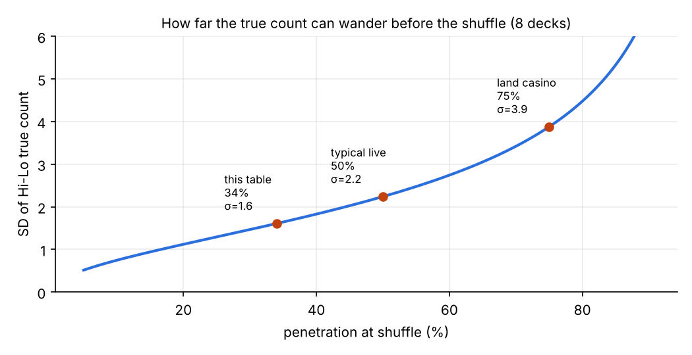

# Live-dealer blackjack: measuring whether card counting is still possible online

An observation-only research pipeline that reads every card dealt at a live-dealer blackjack table
from the game's own UI, reconstructs the shoe, and measures **penetration**: the one number that
decides whether counting can ever produce an edge. No bets are placed; this is a measurement tool.

## Finding

On the table measured (an 8-deck live table), the dealer reshuffled after **138–141 cards in all three
complete shoes recorded: 33–34% penetration**, with a near-fixed cut point.

At that depth the Hi-Lo true count barely moves. Its standard deviation at the shuffle is
σ_TC = √(n · 0.769 · (N−n)/(N−1)) ÷ ((N−n)/52) ≈ **1.6**, against ≈ 3.9 at the 75% typical of land casinos.
Averaged over a shoe, only about 13% of rounds start at TC > +1, worth ≈ +0.35% each under the usual
EV ≈ −0.5% + 0.5%·TC approximation. Perfect Pairs and 21+3 are worse: their edges need the remaining
shoe to be lopsided, which a shallow cut almost never allows (Perfect Pairs goes positive in roughly
1 shoe in 20,000 at this depth).

The counter works; the shallow cut makes its information worthless. Observed end-of-shoe true counts
(+0.1, −3.0, −2.1) are consistent with the theoretical spread.



| Shoe | Cards dealt | Rounds | Penetration | TC at shuffle | TC range |
|---|---|---|---|---|---|
| 0 | 141 | 6 | 33.9% | +0.12 ± 0.32 | −1.17 … +1.35 |
| 1 | 138 | 7 | 33.2% | −3.04 ± 0.46 | −3.04 … +0.84 |
| 2 | 141 | 7 | 33.9% | −2.05 ± 0.39 | −2.46 … +0.25 |

## How it works

Reading physical cards from a compressed stream failed: indices are ~12 px, rotated and overlapping, and
a hand-built glyph reader topped out at ~35% recall. The UI is a far better sensor:

1. **Badge OCR** (`cardcam/badges.py`). Every seat shows its hand total on a dark pill, updated after
   *every* card, with soft totals shown as `7/17`. Seat positions are fixed and calibrated once.
   Icons (bust, double, round end) are matched as whole badges; totals are read per character
   and validated (`2–21`, or `a/b` with b = a+10, or `BJ`).
2. **Card events** (`cardcam/tracker.py`). With aces counted as 1, the change in a hand's low total is
   exactly the card just dealt. Splits are summed, so the identity holds across them. Readings are
   debounced (3 samples at 2 fps) to reject animation flicker.
3. **Rule reconciliation.** Dealer must finish ≥ 17 or bust; a bust from low total L means the card was
   ≥ 22−L; a dealer peeked blackjack (only the up-card registers) fills the hole card exactly.
4. **Count with uncertainty** (`cardcam/count.py`). Bust cards are removed *fractionally*, weighted by
   the remaining composition, and their Hi-Lo variance is propagated as `tc_sd`.

Validation on a 15-minute recording: 171 cards across 10 rounds, 0 rule violations, every checked hand
matched the cards on the felt, and every bust range contained the true card (verified against frames).
`tests/` replays a real round, plus flicker, split and dealer-blackjack cases.

Suits and exact ranks are not available from the UI, so this measures the **main-game** count only.
That loses nothing for blackjack itself: main-game EV depends only on card values.

## Usage

```bash
pip install -r requirements.txt
python tests/test_tracker.py
python scripts/theory.py

ffmpeg -i raw.mp4 -vf fps=2 -c:v libx264 -crf 16 -g 2 run.mp4
python scripts/run_batch.py run.mp4 --shuffles 605 1200 --decks 8
```

`run_batch.py` prints every round hand by hand, the anomaly list and one line per shoe, and writes
`output/count_log_run.csv` (one row per card) and `output/shoes_run.csv` (one row per shoe).
Record fullscreen and start at a shuffle. On a Pi, install OpenCV with `apt install python3-opencv`.

Live, in a notebook, with a **New shoe** button to mark reshuffles:

```python
from cardcam.badges import BadgeReader
from cardcam.live import LiveCounter, notebook_ui
from cardcam.video import frames_from_video, frames_from_camera, make_warp

counter = LiveCounter(BadgeReader("models"))
notebook_ui(counter, frames_from_video("run.mp4", 0.5))
```

For the Pi camera, pass `frames_from_camera(0.5, warp=make_warp(corners))` instead, where `corners`
are the stream's four corners in camera pixels.

`models/` holds the calibration for one table layout at 1920x1080 (seat boxes, badge and character
templates), exported from the calibration notebook with `scripts/export_models.py`. A different table
or window size needs recalibrating.

## Hardware

Raspberry Pi 4 + Camera Module 3, used for capture and processing. Screen capture (or an HDMI capture
dongle into the Pi) is strictly more accurate than filming a monitor; the camera path exists for
completeness and needs a perspective warp to stream coordinates.

## Limits and next steps

- Three shoes from one table is a proof of the method, not a market survey. The useful extension is
  measuring penetration across providers and studios. Below ~50% nothing is countable; 50–65% the main
  game is marginal; 65%+ is where counting and Perfect Pairs become live.
- Bust cards (~6% of cards) are known only as a range; their uncertainty is carried, not hidden.
- Recording must start at a shuffle, or the running count carries an unknown offset.

Observation only. Operators' terms prohibit device-assisted play, and nothing here places or advises bets.
